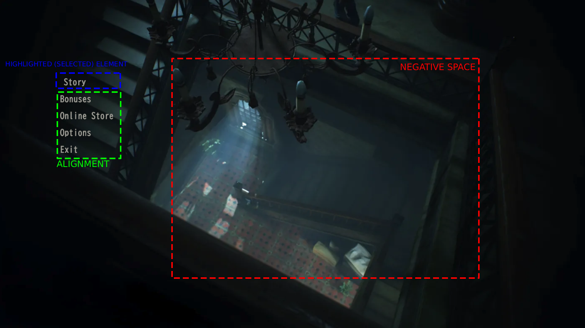
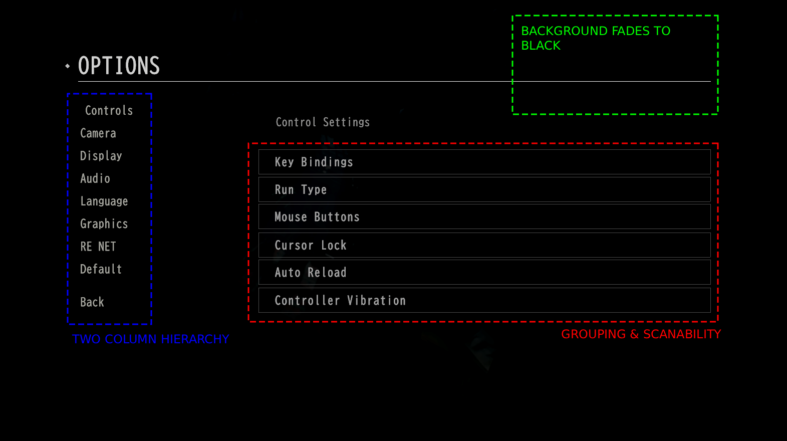
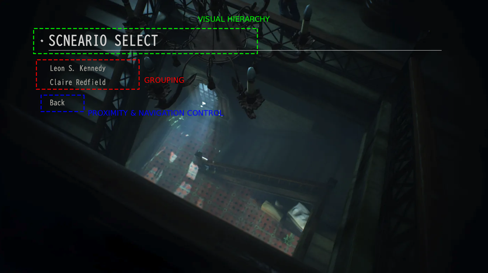
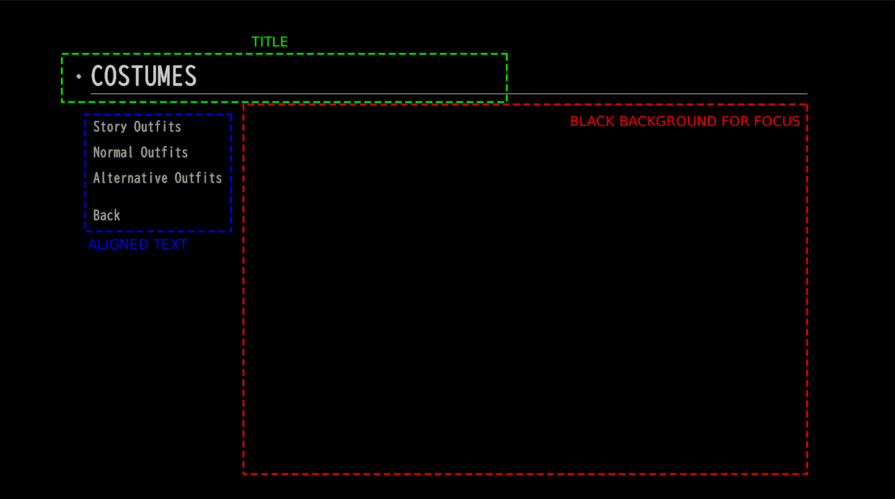

# ITU-CS-464-LAB-07-BSCS25067
**Student Name:** Abdullah Saeed  
**Roll Number:** BSCS25067  
**Inspiration & Visual Reference:** *Resident Evil 2 Remake* (Capcom)

---

## Project Overview & Architecture
This repository contains a 10-screen mobile UI/UX menu system built in Unity, inspired by the sleek survival-horror tactical interface of *Resident Evil 2 Remake*.

## Screen-by-Screen Design Documentation

### Screen 01: Title / Splash Screen (`01_TitleScene.unity`)
- **Purpose:** Establishes the survival-horror R.P.D. terminal tone and provides a clear entry point into the main menu.
- **UI/UX Principles Applied:**
  * **Color & Contrast:** Deep slate background paired with high-contrast white text and Biohazard Crimson accents for the RE emblem.
  * **Visual Hierarchy:** Bold, center-weighted title dominates the screen while secondary system metadata is subdued in grey.
  * **Affordances & Touch Targets:** Large, bordered central prompt creates an unmistakable, thumb-friendly tap zone.
- **Tweens & Ease Curves Used:**
  * **Title Logo (`FadeInOnEnable`):** Fades in (`0 -> 1` alpha over `0.65s`) using **EaseInOutSine** for a smooth, atmospheric reveal.
  * **Start Prompt (`FadeInOutLoop`):** Fades in after a brief delay, then loops continuously between `0.25 <-> 1.0` alpha using **EaseInOutSine** to signal interactivity.
  * **Scene Transition:** Tapping triggers the additive `TransitionScene` shutter overlay using **EaseOutCubic** (close) and **EaseInCubic** (open).

---

### Screen 02: Main Menu (`02_MainMenu.unity`)
- **Purpose:** Serves as the central navigation hub connecting Story Mode, Bonuses, Online Store, Options, and Exit.
- **UI/UX Principles Applied:**
  * **Alignment & Grouping:** Left-aligned vertical button stack (`Story`, `Bonuses`, `Online Store`, `Options`, `Exit`) with uniform vertical spacing for rapid thumb scanning.
  * **Contrast & Figure-Ground:** Crisp white typography is anchored over the darkest shadowed region of the background artwork to guarantee legibility without heavy box borders.
  * **Visual Hierarchy & Negative Space:** Leaving the right two-thirds of the frame unobstructed preserves the survival-horror environment while drawing focus to the left navigation column.
- **Tweens & Ease Curves Used:**
  * **Menu List Fade (`FadeInOnEnable`):** Fades the navigation stack in (`0 -> 1` alpha) using **EaseInOutSine**.
  * **RE2 Highlight Shift (`ShiftHighlight`):** Selecting or hovering a menu item shifts the label to the right using **EaseOutCubic** (`1 - (1 - t)^3`), replicating the signature *Resident Evil 2 Remake* active state.

---

### Screen 03: Story Sub-Menu (`03_StoryMenu.unity`)
- **Purpose:** Provides campaign management options (`Continue`, `Load Game`, `New Game`, `Costumes`) along with a dedicated `Back` navigation return path.
- **UI/UX Principles Applied:**
  * **Visual Hierarchy & Structural Framing:** The bold `+ STORY` header paired with a full-width horizontal divider line immediately establishes current screen context and separates the header from interactive choices.
  * **Grouping & Proximity:** Campaign actions (`Continue`, `Load Game`, `New Game`, `Costumes`) are grouped with tight vertical spacing, while the `Back` button is isolated below with extra padding to prevent accidental mis-taps.
  * **Consistency & Dead-End Prevention:** Retains the left-aligned layout and shadowed background from the Main Menu while providing a clear `Back` control to return to `02_MainMenu`.
- **Tweens & Ease Curves Used:**
  * **Header & Menu Fade (`FadeInOnEnable`):** Smoothly fades the header line and button stack in (`0 -> 1` alpha) using **EaseInOutSine**.
  * **RE2 Highlight Shift (`ShiftHighlight`):** Active or hovered items (such as `Continue`) shift right (`+24px`) using **EaseOutCubic** to indicate selection focus.
  * **Additive Scene Transition:** Selecting a forward path or tapping `Back` invokes `TransitionScene` using **EaseOutCubic** / **EaseInCubic**.

---

### Screen 04: Options / Control Settings (`04_Options.unity`)
- **Purpose:** Displays system configuration categories (`Controls`, `Camera`, `Display`, `Audio`, `Language`, `Graphics`, `RE NET`, `Default`) alongside a structured sub-panel of Control Settings (`Key Bindings`, `Run Type`, `Mouse Buttons`, `Cursor Lock`, `Auto Reload`, `Controller Vibration`).
- **UI/UX Principles Applied:**
  * **Contrast & Readability (Background Dimming):** Because the right-hand settings table spans across the center and right of the screen, the background artwork dynamically fades to near-pure black (`#000000`) so the fine bordered rows and text never clash with background lighting.
  * **Two-Column Split Hierarchy:** Left column houses primary settings categories while the right column displays the contextual `Control Settings` sub-items inside clean, thin-bordered rectangular rows.
  * **Grouping & Alignment:** Uniform vertical row height and consistent left text padding across all six `Control Settings` boxes promote effortless horizontal and vertical scanning.
- **Tweens & Ease Curves Used:**
  * **Background Fade-to-Black (`ColorTweenOnEnable`):** Tweens the background image from full brightness (`#FFFFFF`) down to dark black (`#000000`) using **EaseInOutSine**, prioritizing text contrast and legibility.
  * **Panel & Row Fade (`FadeInOnEnable`):** Fades the `+ OPTIONS` header, left category list, and right `Control Settings` bordered table in (`0 -> 1` alpha) using **EaseInOutSine**.
  * **RE2 Highlight Shift (`ShiftHighlight`):** Active category (`Controls`) and hovered rows shift right (`+24px`) using **EaseOutCubic** (`1 - (1 - t)^3`).

---

### Screen 05: Scenario / Character Select (`05_ScenarioSelect.unity`)
- **Purpose:** Allows the player to choose their campaign protagonist (`Leon S. Kennedy` or `Claire Redfield`) after selecting `New Game` from the Story Sub-Menu, or return via `Back`.
- **UI/UX Principles Applied:**
  * **Consistency & Reusable Layout:** Reuses the top-left header prefab and full-width horizontal divider line to maintain spatial predictability across sub-menus.
  * **Grouping & Proximity:** Both playable protagonists (`Leon S. Kennedy` and `Claire Redfield`) are paired closely together as equal-weight primary choices, while `Back` is visually separated below to prevent mis-taps.
  * **Contrast & Negative Space:** Anchors the protagonist choices over the dark stairwell shadow on the left while preserving the atmospheric R.P.D. main hall on the right.
- **Tweens & Ease Curves Used:**
  * **Header & Character List Fade (`FadeInOnEnable`):** Fades the scenario header and character options in (`0 -> 1` alpha) using **EaseInOutSine**.
  * **RE2 Highlight Shift (`ShiftHighlight`):** Selecting or hovering either protagonist or `Back` shifts the label right (`+24px` over `0.18s`) using **EaseOutCubic** (`1 - (1 - t)^3`).
  * **Additive Scene Transition:** Selecting a character advances forward (or `Back` returns to `03_StoryMenu`) via the additive `TransitionScene` shutter overlay (**EaseOutCubic** / **EaseInCubic**).

---

### Screen 06: Costumes Menu (`06_CostumesMenu.unity`)
- **Purpose:** Allows players to preview and select character alternative cosmetic appearances (`Story Outfits`, `Normal Outfits`, `Alternative Outfits`) or return via `Back`[cite: 17].
- **UI/UX Principles Applied:**
  * **Consistency & Visual Hierarchy:** Reuses the established `PF_HeaderBar` prefab and full-width horizontal rule (`+ COSTUMES`) to preserve structural continuity from the Story Sub-Menu[cite: 17].
  * **Contrast & Readability (Solid Dark Backdrop):** Keeps the background faded to pure black (`#000000`) matching the Options menu to provide a clean, uncluttered presentation for outfit categories[cite: 17].
  * **Grouping & Proximity:** Outfit categories are grouped tightly with uniform vertical list spacing, with the `Back` button isolated at the bottom for quick, unambiguous exit navigation[cite: 17].
- **Tweens & Ease Curves Used:**
  * **Panel Fade (`FadeInOnEnable`):** Fades the header and costume list in (`0 -> 1` alpha) using **EaseInOutSine**.
  * **RE2 Highlight Shift (`ShiftHighlight`):** Hovering or selecting any outfit category or the `Back` button shifts the label to the right (`+24px` over `0.18s`) using **EaseOutCubic** (`1 - (1 - t)^3`)[cite: 17].
  * **Panel Switcher Transition:** Opening or exiting this menu triggers smooth alpha cross-fading managed by `UIPanelSwitcher`[cite: 17].

---

## Credits & References
- **UI Visual Direction & Color Palette Inspiration:** *Resident Evil 2 Remake* (Capcom, 2019).
- **Images & Background:** IGN [link](https://nordic.ign.com/resident-evil-2/15946/e3-2018-resident-evil-2-returns-to-its-horror-roots-in-the-best-way)