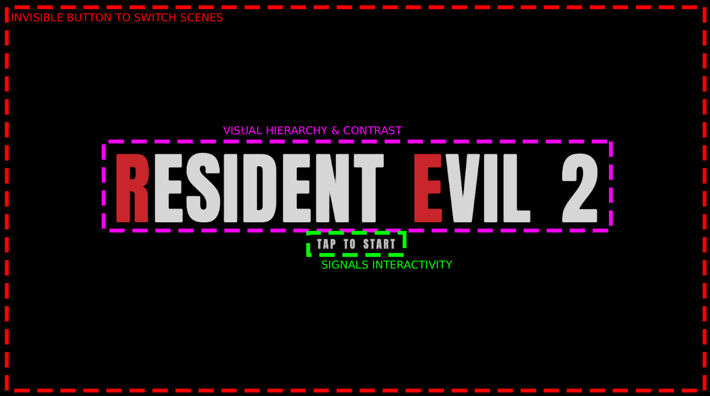
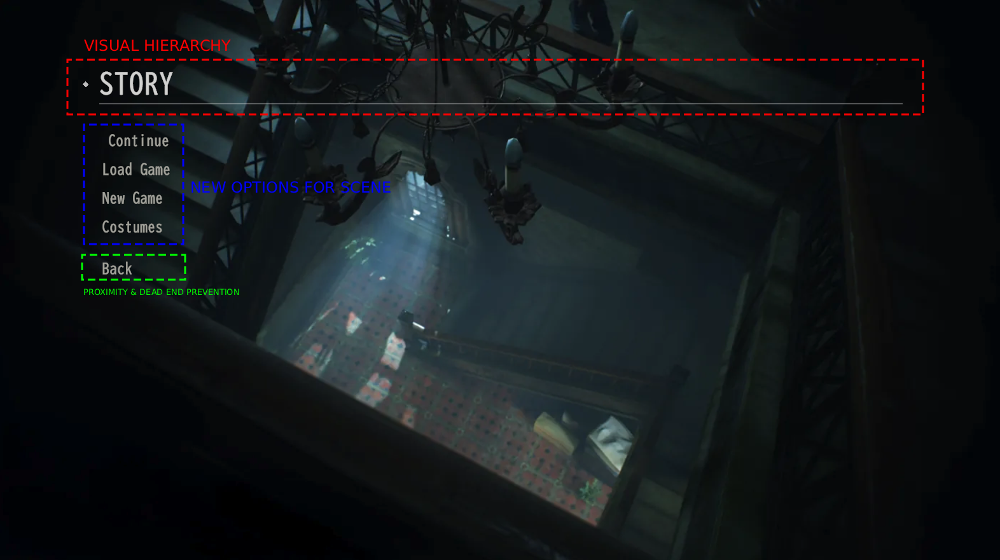

# ITU-CS-464-LAB-07-BSCS25067
**Student Name:** Abdullah Saeed  
**Roll Number:** BSCS25067  
**Inspiration & Visual Reference:** *Resident Evil 2 Remake* (Capcom)

---

## Project Overview & Architecture
This repository contains a 10-screen mobile UI/UX menu system built in Unity, inspired by the sleek survival-horror tactical interface of *Resident Evil 2 Remake*.

## Screen-by-Screen Design Documentation

### Screen 01: Title / Splash Screen (`01_TitleScene.unity`)
- **Purpose:** Establishes the survival-horror R.P.D. terminal tone and provides a clear entry point into the main menu.
- **UI/UX Principles Applied:**
  * **Color & Contrast:** Deep slate background paired with high-contrast white text and Biohazard Crimson accents for the RE emblem.
  * **Visual Hierarchy:** Bold, center-weighted title dominates the screen while secondary system metadata is subdued in grey.
  * **Affordances & Touch Targets:** Large, bordered central prompt creates an unmistakable, thumb-friendly tap zone.
- **Tweens & Ease Curves Used:**
  * **Title Logo (`FadeInOnEnable`):** Fades in (`0 -> 1` alpha over `0.65s`) using **EaseInOutSine** for a smooth, atmospheric reveal.
  * **Start Prompt (`FadeInOutLoop`):** Fades in after a brief delay, then loops continuously between `0.25 <-> 1.0` alpha using **EaseInOutSine** to signal interactivity.
  * **Scene Transition:** Tapping triggers the additive `TransitionScene` shutter overlay using **EaseOutCubic** (close) and **EaseInCubic** (open).

---

### Screen 02: Main Menu (`02_MainMenu.unity`)
- **Purpose:** Serves as the central navigation hub connecting Story Mode, Bonuses, Online Store, Options, and Exit[cite: 5].
- **UI/UX Principles Applied:**
  * **Alignment & Grouping:** Left-aligned vertical button stack (`Story`, `Bonuses`, `Online Store`, `Options`, `Exit`) with uniform vertical spacing for rapid thumb scanning.
  * **Contrast & Figure-Ground:** Crisp white typography is anchored over the darkest shadowed region of the background artwork to guarantee legibility without heavy box borders.
  * **Visual Hierarchy & Negative Space:** Leaving the right two-thirds of the frame unobstructed preserves the survival-horror environment while drawing focus to the left navigation column.
- **Tweens & Ease Curves Used:**
  * **Menu List Fade (`FadeInOnEnable`):** Fades the navigation stack in (`0 -> 1` alpha) using **EaseInOutSine**.
  * **RE2 Highlight Shift (`ShiftHighlight`):** Selecting or hovering a menu item shifts the label to the right using **EaseOutCubic** (`1 - (1 - t)^3`), replicating the signature *Resident Evil 2 Remake* active state.

---

### Screen 03: Story Sub-Menu (`03_StoryMenu.unity`)
- **Purpose:** Provides campaign management options (`Continue`, `Load Game`, `New Game`, `Costumes`) along with a dedicated `Back` navigation return path.
- **UI/UX Principles Applied:**
  * **Visual Hierarchy & Structural Framing:** The bold `+ STORY` header paired with a full-width horizontal divider line immediately establishes current screen context and separates the header from interactive choices[cite: 7].
  * **Grouping & Proximity:** Campaign actions (`Continue`, `Load Game`, `New Game`, `Costumes`) are grouped with tight vertical spacing, while the `Back` button is isolated below with extra padding to prevent accidental mis-taps.
  * **Consistency & Dead-End Prevention:** Retains the left-aligned layout and shadowed background from the Main Menu while providing a clear `Back` control to return to `02_MainMenu`.
- **Tweens & Ease Curves Used:**
  * **Header & Menu Fade (`FadeInOnEnable`):** Smoothly fades the header line and button stack in (`0 -> 1` alpha) using **EaseInOutSine**.
  * **RE2 Highlight Shift (`ShiftHighlight`):** Active or hovered items (such as `Continue`) shift right (`+24px`) using **EaseOutCubic** to indicate selection focus.
  * **Additive Scene Transition:** Selecting a forward path or tapping `Back` invokes `TransitionScene` using **EaseOutCubic** / **EaseInCubic**.

---

## Credits & References
- **UI Visual Direction & Color Palette Inspiration:** *Resident Evil 2 Remake* (Capcom, 2019).